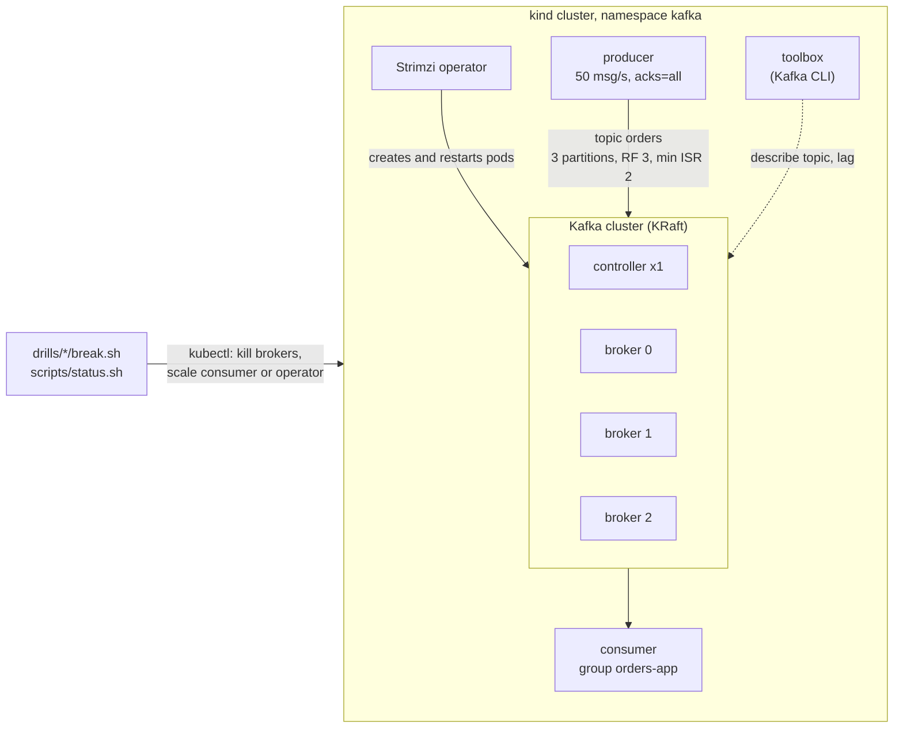

# Kafka failure drills

A 3-broker Kafka cluster on Kubernetes, broken on purpose in three ways, with what
actually happened and a runbook for each.

Runs locally on kind with the [Strimzi](https://strimzi.io) operator (Strimzi 1.3.1, Kafka 4.3.2, KRaft).

## Architecture



The controller runs in its own pool, so killing brokers never breaks the metadata quorum. Drill 3 scales the Strimzi operator to 0 first, so killed brokers stay down.

## Setup

| Part | Detail |
|---|---|
| Cluster | 1 KRaft controller + 3 brokers (separate pools, so killing brokers never breaks the metadata quorum) |
| Topic `orders` | 3 partitions, replication factor 3, `min.insync.replicas=2` |
| Producer | 50 msg/s, `acks=all`, 10 s delivery timeout (so failures show quickly) |
| Consumer | One consumer in group `orders-app` |

**The replication math.** Every partition has 3 copies (replication factor 3). A write with `acks=all` only succeeds when at least `min.insync.replicas=2` copies have it. So the cluster can lose **1 broker** and keep accepting writes with no data loss. Losing **2** leaves 1 in-sync copy, below the minimum, so Kafka **rejects** writes instead of keeping a single copy. The drills test exactly these two cases.

## Results

| Drill | What we broke | What happened | Runbook |
|---|---|---|---|
| [1. Broker down](drills/01-broker-down) | Killed 1 of 3 brokers | All partitions under-replicated, one leader failed over, one 503 ms latency spike, **no errors**. Back in sync in ~25 s. | [runbook](drills/01-broker-down/runbook.md) |
| [2. Consumer lag](drills/02-consumer-lag) | Stopped the consumer for ~70 s | Lag grew at ~50 msg/s to 2,403. Producer unaffected. Caught up in under 18 s once restarted. | [runbook](drills/02-consumer-lag/runbook.md) |
| [3. Not enough replicas](drills/03-not-enough-replicas) | Killed 2 of 3 brokers (operator stopped so they stay down) | Brokers returned `NOT_ENOUGH_REPLICAS` 1,079 times; writes **rejected for ~3.5 min rather than stored on one broker**. Full recovery once brokers returned. | [runbook](drills/03-not-enough-replicas/runbook.md) |

Each drill folder has `break.sh` (the drill), `output.txt` (the real run) and `runbook.md`.

## How each drill works

| Drill | What `break.sh` does | What to watch (`scripts/status.sh`) | Why it behaves that way |
|---|---|---|---|
| 1. Broker down | `kubectl delete pod drills-broker-1`, then watch for 90 s | ISR shrinks from `0,1,2` to two brokers; under-replicated partitions go to 3; a leader moves | 2 in-sync copies still meet `min.insync.replicas=2`, so writes continue. Strimzi recreates the pod, and the broker catches up from the leaders. |
| 2. Consumer lag | `kubectl scale deploy/consumer --replicas=0` for 60 s, then back to 1 | Lag per partition from `kafka-consumer-groups.sh --describe` | Producers and consumers are separate. Messages wait on disk, and the consumer resumes from its committed offset. |
| 3. Not enough replicas | Scale the Strimzi operator to 0, delete brokers 1 and 2, wait, then scale the operator back | ISR shrinks to `0`; producer logs `NOT_ENOUGH_REPLICAS`, then `TimeoutException` after the 10 s delivery timeout | 1 in-sync copy is below the minimum of 2, so the leader refuses `acks=all` writes. The operator is stopped first, otherwise it would recreate the brokers within seconds. |

`scripts/status.sh` runs the Kafka CLI from a toolbox pod:
- `kafka-topics.sh --describe` shows the leader, replicas and ISR of each partition
- `--under-replicated-partitions` gives the under-replicated count
- `kafka-consumer-groups.sh --describe --group orders-app` shows lag

`scripts/watch.sh` repeats it alongside the producer's latest line.

## What I learned

1. **One broker down is a non-event** when replication factor is 3 and `min.insync.replicas=2`. The
   alert to watch is `UnderReplicatedPartitions`, not producer errors.
2. **Lag is a consumer problem, not a broker problem.** Kafka holds the data; the question is
   whether consumers catch up before retention deletes it.
3. **`acks=all` + `min.insync.replicas` trades availability for safety.** With 2 brokers gone, Kafka
   refused writes instead of keeping a single copy. The producer must handle that failure.
4. **After recovery, leadership is uneven.** Returning brokers come back as followers. Kafka moves
   leaders back on its own every 5 minutes (`auto.leader.rebalance.enable`), or you can force it with
   `kafka-leader-election.sh --election-type PREFERRED`.

## Design decisions

| Decision | Why |
|---|---|
| Separate KRaft controller pool (1 controller, 3 brokers) | With combined nodes, killing 2 brokers would also lose the controller quorum. Drill 3 would then show metadata timeouts instead of the clean `NOT_ENOUGH_REPLICAS` rejection it is meant to show. |
| Producer uses `acks=all`, `request.timeout.ms=5000`, `delivery.timeout.ms=10000` | `acks=all` is what makes `min.insync.replicas` matter. Short timeouts make failures show in seconds instead of the 2-minute default. |
| Scale the Strimzi operator to 0 in drill 3 | The operator recreates deleted broker pods almost at once. Stopping it is the simplest way to keep 2 brokers down. |
| Temporary (ephemeral) storage | Fast to create and delete. A returning broker starts empty and copies its data back from the leaders, which is visible in the drill output. |
| Toolbox pod for the CLI | The status checks keep working even when the broker they would otherwise run on is the one being killed. |
| Strimzi and the operator pinned (1.3.1, Kafka 4.3.2) | `scripts/up.sh` installs the same version every time. |

## Run it

Needs Docker (about 6 GB RAM), kind and kubectl.

```bash
scripts/up.sh                              # cluster, Strimzi, Kafka, traffic (first run downloads images)
scripts/status.sh                          # pods, leaders, ISR, under-replicated partitions, lag
drills/01-broker-down/break.sh
drills/02-consumer-lag/break.sh
drills/03-not-enough-replicas/break.sh
scripts/down.sh                            # delete everything
```

## Layout

```
cluster/   kind.yaml, kafka.yaml (node pools, Kafka, topic), load.yaml (producer, consumer, toolbox)
scripts/   up.sh, down.sh, status.sh, watch.sh
drills/    one folder per drill: break.sh, output.txt, runbook.md
```
